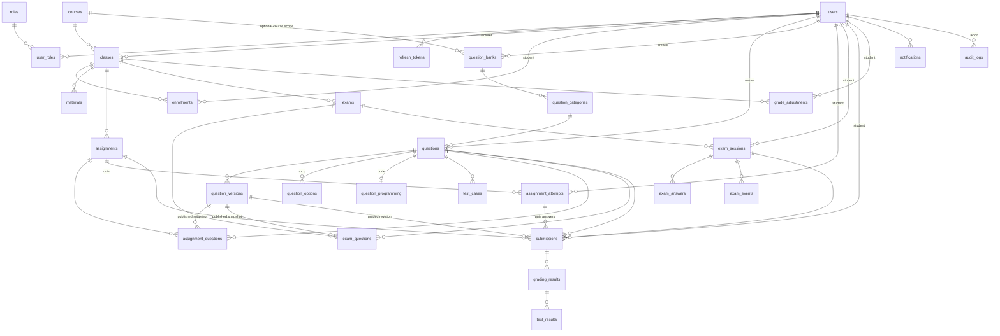

# Thiết kế CSDL — LMS (MySQL 8)

| | |
|---|---|
| Phiên bản | 1.4 — 2026-10-25 |
| Nguồn yêu cầu | `srs.md` (M1–M10, BR1–BR15) |
| Công nghệ | MySQL 8.4, InnoDB, utf8mb4, Spring Data JPA + Flyway migration |

Quy ước: PK `id BIGINT AUTO_INCREMENT`; timestamps `DATETIME` (UTC, app-level); soft-delete chỉ cho `questions` (tái sử dụng); user không xóa cứng (dùng `status='locked'`). FK mặc định `RESTRICT`.

## 1. ERD (tổng quan)



## 2. Bảng chi tiết

### 2.1 Danh tính (M1)

**users**
| Cột | Kiểu | Ghi chú |
|---|---|---|
| id | BIGINT PK AI | |
| email | VARCHAR(255) UNIQUE | NOT NULL |
| password_hash | VARCHAR(255) | argon2id |
| full_name | NVARCHAR(150) | |
| student_code | VARCHAR(20) UNIQUE NULL | sinh viên |
| phone | VARCHAR(20) NULL | liên hệ cá nhân |
| avatar_path | VARCHAR(255) NULL | đường dẫn file trong `storage/avatars/` (upload, không base64) |
| status | ENUM('active','locked') | default active |
| last_login_at | DATETIME NULL | |
| created_at / updated_at | DATETIME | |

**roles** — id TINYINT PK, name VARCHAR(30) UNIQUE ('student','lecturer','admin'), description. Seed 3 dòng.
**user_roles** — PK(user_id, student FK → users/roles).
**refresh_tokens** — id PK, user_id FK, token_hash CHAR(64) UNIQUE (SHA-256 của token), expires_at, revoked_at NULL, created_at. Index (user_id).

### 2.2 Khóa học & lớp (M2)

**courses** — id, code VARCHAR(20) UNIQUE, name NVARCHAR(200), description TEXT, credits TINYINT UNSIGNED default 3 (1–10), created_by FK users, created_at.
**classes** — id, course_id FK, code VARCHAR(30), name NVARCHAR(200), semester VARCHAR(20) (vd '2026.1'), lecturer_id FK users, max_students INT UNSIGNED NULL (NULL = không giới hạn; BR12: không được < sĩ số hiện tại), enroll_from DATETIME NULL, enroll_until DATETIME NULL (NULL/NULL = luôn mở; enroll_until > enroll_from), room VARCHAR(50) NULL, schedule VARCHAR(100) NULL, status ENUM('active','locked') default 'active', grade_policy JSON NULL (`{"weights":{"attendance":10,"assignment":20,"midterm":20,"final":50},"attendance":{"max_absences":null,"absent_penalty":2,"late_penalty":0.5,"excused_penalty":0}}` — NULL = mặc định, `class-schedule-grades-spec.md` §5), created_at. UNIQUE(course_id, code); index (semester), (enroll_until).
**enrollments** — id, class_id FK, student_id FK, status ENUM('active','dropped') default active, enrolled_at, enrolled_via ENUM('lecturer','self') default 'lecturer'. UNIQUE(class_id, student_id); index (student_id).

### 2.3 Học liệu (M3)

**materials** — id, class_id FK, session_id FK class_sessions NULL (học liệu của buổi), title NVARCHAR(200), description TEXT NULL, type ENUM('pdf','doc','slide','link','video','archive','other'), file_path VARCHAR(500) NULL (link → URL), size_bytes BIGINT default 0, uploaded_by FK, created_at. Index (class_id, created_at).

### 2.4 Ngân hàng câu hỏi (M4)

**question_banks** — id, course_id FK courses NULL, owner_id FK users, name VARCHAR(100), description TEXT NULL, visibility (`private`/`shared`), created_by FK users, created_at. Một học phần có thể có nhiều ngân hàng do các giảng viên phụ trách tạo. Dòng `course_id` NULL cũ được giữ để tương thích dữ liệu; không tạo thêm ngân hàng cá nhân mới. `shared` cho giảng viên cùng học phần xem và dùng câu hỏi; chủ sở hữu hoặc người được cấp quyền `edit` mới được sửa. Admin có quyền giám sát/xử lý đặc biệt.

**question_bank_permissions** — PK(bank_id FK, lecturer_id FK), permission (`view`/`edit`), granted_at. Chỉ giảng viên hiện được phân công vào học phần của ngân hàng mới sử dụng quyền đã cấp. Chuyển đổi dữ liệu cũ giữ quyền sửa cho giảng viên từng quản lý ngân hàng học phần chung.

**question_categories** — id, bank_id FK question_banks, name VARCHAR(100), created_by FK users, created_at. UNIQUE(bank_id, name). Mỗi ngân hàng có danh mục hệ thống “Chưa phân loại” (không đổi tên/xóa); danh mục phẳng khác là tùy chọn, dùng để nhóm theo chương/chủ đề. Không dùng chuỗi `topic` tự do để thay thế danh mục.

**questions** — id, owner_id FK users (người tạo), category_id FK question_categories NOT NULL (backend tự gán danh mục “Chưa phân loại” nếu request không chọn), type ENUM('mcq','multiple_choice','true_false','short_answer','numeric','fill_blank','matching','ordering','programming'), content TEXT (Markdown), topic VARCHAR(100) NULL (không dùng trên UI), difficulty ENUM('easy','medium','hard') default 'medium', explanation TEXT NULL, scoring_mode VARCHAR(20) default 'all_or_nothing', answer_spec JSON NULL (đáp án loại `short_answer`/`numeric`/`fill_blank`/`matching`/`ordering`, `assessment-spec.md` §1.2), is_deleted BOOL default 0, created_at, updated_at. Đây là bản hiện hành trong ngân hàng; chỉnh sửa tạo nội dung cho phiên bản mới, không sửa snapshot đã được assessment xuất bản sử dụng. Index (owner_id, type), (category_id, type, difficulty, is_deleted).

**question_versions** — id, question_id FK, version_no INT, snapshot JSON, created_by FK users, created_at. UNIQUE(question_id, version_no). `snapshot` giữ toàn bộ dữ liệu cần để hiển thị/chấm phiên bản đó (`assessment-spec.md` §2): type, content, explanation, scoring_mode, options kèm đáp án đúng, answer_spec, phần lập trình (ngôn ngữ, giới hạn, checker, starter code theo ngôn ngữ, lời giải), test case theo thứ tự. Bản ghi là append-only; một lần lưu tạo tối đa một version, không tạo nếu snapshot giống bản mới nhất.

**question_options** — id, question_id FK, content TEXT, is_correct BOOL, position INT UNSIGNED. Index (question_id).

**question_programming** — question_id PK/FK; starter_code TEXT NULL (cũ), starter_codes JSON NULL (map ngôn ngữ → code), solution_code MEDIUMTEXT NULL, solution_language VARCHAR(10) NULL, allowed_languages JSON NOT NULL về nghiệp vụ (≥ 1 ngôn ngữ; dòng cũ NULL được migration điền cả 4), time_limit_ms INT UNSIGNED default 1000, memory_limit_mb INT UNSIGNED default 256, checker_mode VARCHAR(10) default 'token', checker_epsilon DOUBLE NULL.

**test_cases** — id, question_id FK, input MEDIUMTEXT, expected_output MEDIUMTEXT, is_public BOOL default 0 (test công khai = ví dụ mẫu), weight DECIMAL(5,2) default 1.0 (không dùng — chấm nhị phân), position INT UNSIGNED. Index (question_id).

### 2.5 Bài tập (M5)

**assignments** — id, class_id FK, title NVARCHAR(200), description TEXT, category VARCHAR(20) CHECK IN ('quiz','assignment','midterm','final') default 'assignment', available_from DATETIME NULL, due_at DATETIME, allow_late BOOL default 0, late_due_at DATETIME NULL, late_penalty_percent INT UNSIGNED default 0, max_attempts INT NULL (NULL = không giới hạn), score_policy ENUM('best','last') default 'best', review_mode VARCHAR(20) default 'after_close' (`never`/`after_submit`/`after_close`), review_shows_answers BOOL default 1, shuffle_questions BOOL default 0, shuffle_options BOOL default 0, is_published BOOL default 0, created_by FK, created_at, updated_at. `available_from`, `due_at` và `late_due_at` lưu UTC; web đổi giờ địa phương sang UTC trước khi gọi API. Giảng viên có thể tạo cùng nội dung cho nhiều lớp thuộc một học phần trong một giao dịch; mỗi lớp nhận một dòng assignment độc lập để quản lý bài nộp/điểm. `category='quiz'` nhận mọi loại câu trừ `programming`; `max_attempts` tính theo toàn bài quiz, còn các hạng mục khác tính theo từng câu. Index (class_id, due_at).

**assignment_questions** — id, assignment_id FK, question_id FK (nguồn trong bank), question_version_id FK NULL (được ghim khi publish), points DECIMAL(6,2), position INT UNSIGNED. UNIQUE(assignment_id, question_id). Sau publish, hạng mục, số lượt/cách tính điểm và các dòng câu hỏi/snapshot/điểm/thứ tự bất biến; muốn sửa phải tạo assignment nháp mới. Giảng viên phụ trách vẫn có thể điều chỉnh tiêu đề, mô tả và lịch theo FR-ASG-07; thay đổi có audit và không cập nhật submission đã lưu.

**assignment_attempts** — lượt nộp **toàn bài quiz**: id, assignment_id FK, student_id FK users, attempt_no INT, is_late BOOL default 0, late_penalty_percent INT UNSIGNED, score DECIMAL(8,2), idempotency_key CHAR(36) UNIQUE, submitted_at DATETIME. UNIQUE(assignment_id, student_id, attempt_no); index (student_id, submitted_at). Chỉ tạo khi nộp quiz chính thức; tạo lượt và toàn bộ submission MCQ của lượt trong cùng transaction. Điểm lượt = tổng điểm các câu sau phạt muộn, câu không trả lời = 0.

### 2.6 Kỳ thi (M7)

**exams** — id, class_id FK, title NVARCHAR(200), grade_category ENUM('midterm','final'), rules_text TEXT, duration_minutes INT, opens_at DATETIME, closes_at DATETIME, shuffle_questions BOOL default 0, is_published BOOL default 0, created_by FK, created_at, updated_at. `grade_category` xác định kỳ thi đóng góp vào hạng mục sổ điểm nào. Sau publish, exam và nội dung assessment bất biến; muốn đổi phải tạo exam nháp mới. Index (class_id, opens_at).

**exam_questions** — id, exam_id FK, question_id FK (nguồn trong bank), question_version_id FK NULL (được ghim khi publish), points DECIMAL(6,2), position SMALLINT. UNIQUE(exam_id, question_id).

**exam_sessions** — id, exam_id FK, student_id FK, started_at, ends_at (= min(started_at + duration, closes_at), server tính), status ENUM('in_progress','submitted','auto_submitted'), submitted_at NULL, ip VARCHAR(45). UNIQUE(exam_id, student_id); **index (status, ends_at)** cho sweeper auto-submit.

**exam_answers** — id, exam_session_id FK, question_id FK, selected_option_ids JSON NULL (MCQ), code_text MEDIUMTEXT NULL (draft code), updated_at. UNIQUE(exam_session_id, question_id).

**exam_events** — id, exam_session_id FK, event ENUM('start','autosave','ws_disconnect','ws_reconnect','submit','auto_submit'), detail JSON NULL, created_at. Index (exam_session_id).

### 2.7 Nộp bài & chấm (M5/M6) ⭐

**submissions** — bảng thống nhất 2 loại bài nộp (quiz + code). Migration M5 tạo các cột assignment bên dưới; migration M7 bổ sung `exam_session_id` và ràng buộc bài nộp thuộc assignment hoặc phiên thi:
| Cột | Kiểu | Ghi chú |
|---|---|---|
| id | BIGINT PK AI | |
| student_id | FK users | |
| assignment_id | FK NULL | bài thường |
| assignment_attempt_id | FK assignment_attempts NULL | chỉ có ở quiz; gom các câu thuộc một lượt toàn bài |
| exam_session_id | FK NULL | bài thi — CHECK: ít nhất 1 trong 2 NOT NULL |
| question_id | FK questions | nộp theo từng câu |
| question_version_id | FK question_versions | phiên bản câu được giao; dùng khi đọc đề và regrade |
| type | ENUM('mcq','code') | `mcq` = mọi câu khách quan chấm đồng bộ |
| selected_option_ids | JSON NULL | câu lựa chọn |
| response | JSON NULL | câu trả lời đã chuẩn hóa của câu khách quan (`assessment-spec.md` §3.2) |
| language | VARCHAR(20) NULL | code |
| source_code | MEDIUMTEXT NULL | code (≤16MB đủ; đường mở rộng: object storage) |
| attempt_no | INT | quiz: bằng `assignment_attempts.attempt_no`; bài khác: đếm theo (assignment, student, question); bài thi: 1 |
| status | ENUM('pending','grading','completed','failed') | code; MCQ tạo xong là completed |
| score | DECIMAL(8,2) NULL | điểm câu theo thang points sau phạt muộn; code: AC = points, khác = 0, `failed` = NULL |
| is_late | BOOL default 0 | |
| idempotency_key | CHAR(36) UNIQUE NULL | bài nộp từng câu; quiz lưu key ở `assignment_attempts`, các dòng câu để NULL |
| submitted_at | DATETIME | |

Index: UNIQUE(assignment_id, student_id, question_id, attempt_no); UNIQUE(assignment_attempt_id, question_id); (student_id, submitted_at); (exam_session_id). Với quiz, mọi câu trong cùng lượt dùng chung `assignment_attempt_id` và `attempt_no`, kể cả câu bỏ trống (`selected_option_ids` NULL, điểm 0); bài khác để `assignment_attempt_id` NULL. Bài thi không thuộc `assignment_attempts`.

**grading_results** — id, submission_id FK, grading_job_id FK unique, attempt_no INT, status VARCHAR(20) ('graded'/'failed'), verdict VARCHAR(16) NULL (`AC`/`WA`/`CE`/`TLE`/`MLE`/`RE`/`OLE`/`SYSTEM_ERROR`), total_score DECIMAL(8,2) NULL (không dùng), compile_error BOOLEAN, compile_output MEDIUMTEXT NULL, error_message TEXT NULL, tests_total INT NULL, tests_passed INT NULL, failed_test INT NULL, graded_at, duration_ms INT. Unique (submission_id, attempt_no). Mỗi lần chấm/chấm lại là một dòng; dòng mới nhất quyết định verdict và điểm.

M6 API (Flyway V14) lưu outbox và snapshot đã ghim. `grading_results` là lịch sử verdict; `submissions.verdict` là verdict mới nhất để list lịch sử nộp. API là tiến trình duy nhất ghi trạng thái/verdict; worker chỉ SELECT bài/snapshot/run job và publish event.

**test_results** — id, grading_result_id FK, test_case_position INT, status VARCHAR(16) (verdict test `AC`/`WA`/`TLE`/`MLE`/`RE`/`OLE`), output MEDIUMTEXT NULL (cắt 4 KiB), time_ms INT, memory_kb INT NULL, score DECIMAL(8,2) default 0 (không dùng). UNIQUE(grading_result_id, test_case_position). Chỉ gồm test đã chạy.

**run_jobs** — chạy thử/kiểm tra đề, không phải bài nộp: id, job_id CHAR(36) UNIQUE, kind VARCHAR(20) (`problem_check`/`draft_check`/`practice_run`), requested_by FK users, question_id FK NULL, question_version_id FK NULL (`problem_check`: phiên bản đã kiểm tra), assignment_id FK NULL, payload JSON (code, ngôn ngữ, giới hạn, checker, test), status VARCHAR(16) (`pending`/`running`/`completed`/`failed`), verdict VARCHAR(16) NULL, result JSON NULL, created_at, next_attempt_at, published_at NULL, publish_attempts INT, completed_at NULL. Index (question_version_id, kind, created_at), (requested_by, created_at), (published_at, next_attempt_at). Outbox giống `grading_jobs`.

### 2.8 Điểm (M8)

Điểm thành phần tính từ dữ liệu sẵn có (điểm danh, bài nộp) theo `class-schedule-grades-spec.md` §5 — **không** lưu bảng tổng; chỉ lưu điểm nhập tay/CSV/kỳ thi và ghi đè:

**grade_entries** — id, class_id FK, student_id FK users, component ENUM('attendance','assignment','midterm','final'), score DECIMAL(4,2) (0–10), source ENUM('manual','csv','exam'), reason VARCHAR(500) NULL, updated_by FK users, updated_at. UNIQUE(class_id, student_id, component). Mỗi sinh viên có tối đa một bản ghi cho mỗi thành phần: nếu có thì nó thay điểm hệ thống; `source` cho biết nguồn (`manual` = giảng viên ghi đè, `csv` = nhập CSV, `exam` = kỳ thi M7). Ghi đè tay thay luôn điểm CSV; xóa bản ghi để quay về điểm hệ thống. Mọi thay đổi ghi `audit_logs` (`grade.override`, `grade.import`).

Bảng `grade_adjustments` của thiết kế cũ không dùng (thay bằng ghi đè theo thành phần).

### 2.10 Lịch học, điểm danh, đơn xin nghỉ (M11)

**class_sessions** — id, class_id FK, session_no INT, session_date DATE (lịch VN), start_period TINYINT (1–14), end_period TINYINT, starts_at DATETIME (UTC), ends_at DATETIME (UTC), room VARCHAR(50) NULL, mode ENUM('in_person','online'), title VARCHAR(200) NULL, note TEXT NULL, is_cancelled BOOL default 0, attendance_taken_at DATETIME NULL, created_by FK, created_at, updated_at. UNIQUE(class_id, session_no); index (class_id, starts_at), (starts_at) cho thông báo sắp diễn ra. Cột `upcoming_notified_at` DATETIME NULL đánh dấu đã gửi thông báo 30 phút trước.

**attendance_records** — id, session_id FK, student_id FK users, status ENUM('present','late','excused','absent'), note VARCHAR(255) NULL, marked_by FK users, marked_at. UNIQUE(session_id, student_id); index (student_id).

**leave_requests** — id, class_id FK, session_id FK, student_id FK users, reason TEXT, evidence_path VARCHAR(500), evidence_name VARCHAR(255), evidence_size INT, evidence_type VARCHAR(100), status ENUM('pending','approved','rejected','cancelled'), review_note VARCHAR(500) NULL, reviewed_by FK users NULL, reviewed_at NULL, created_at. Index (class_id, status), (session_id, student_id). Tệp lưu dưới `storage/leave-requests/{class_id}/`.

### 2.9 Thông báo / Audit / Cấu hình (M9/M10)

**notifications** — id, user_id FK, type VARCHAR(40) ('assignment.published','submission.graded','exam.published','grade.released','material.created','enrollment.created','session.upcoming','leave_request.created','leave_request.reviewed','grade.updated'), title VARCHAR(200), body TEXT NULL, data JSON NULL (vd submission_id), is_read BOOL default 0, created_at. Index (user_id, is_read, created_at).

**audit_logs** — id, actor_id FK NULL (NULL = system), action VARCHAR(60) ('user.update','role.assign','grade.adjust','exam.publish','settings.update','submission.regrade'...), entity_type VARCHAR(40), entity_id BIGINT, old_value JSON, new_value JSON, ip VARCHAR(45), created_at. Index (entity_type, entity_id), (actor_id, created_at), (created_at). **Append-only.**

**system_settings** — setting_key VARCHAR(60) PK, setting_value JSON, description VARCHAR(255), updated_by FK, updated_at. Keys: `allowed_languages`, `default_time_limit_ms`, `default_memory_limit_mb`, `max_upload_mb`.

## 3. Máy trạng thái

```
Submission(code):  pending ──worker pick──▶ grading ──ok──▶ completed
                       │                      └──system error (sau retry)──▶ failed
MCQ submit:        tạo là completed (chấm đồng bộ)
ExamSession:       in_progress ──submit──▶ submitted
                       └──── hết ends_at (sweeper) ────▶ auto_submitted
```

## 4. Chiến lược hiệu năng & khối lượng

- Index nóng khớp truy vấn: gradebook đọc theo (class → assignments → submissions theo student); monitor thi đọc (exam_id, status).
- Search danh sách (FR-CRS-06): email/student_code đã UNIQUE-index; `classes(semester)`, `classes(enroll_until)` phục vụ catalog; search `full_name`/`title` dùng LIKE prefix + index thường ở quy mô môn học (không fulltext engine). Catalog đếm sĩ số bằng subquery COUNT, KHÔNG N+1.
- Bảng tăng nhanh: submissions, test_results, audit_logs, exam_events → chỉ giữ cột cần, output/log truncate 64KB, code MEDIUMTEXT.
- Điểm/số liệu tổng hợp: query + cache app-level ngắn (60s) nếu cần; v1 ưu tiên query thẳng, đo trước tối ưu.
- Charset utf8mb4 + collation utf8mb4_0900_ai_ci toàn hệ thống (tiếng Việt).
- Migration: Flyway. DB đã có Alembic schema được baseline ở version 4; DB mới chạy V1–V4. Mỗi thay đổi schema sau đó phải qua migration versioned (bắt đầu V5), cấm sửa tay.
