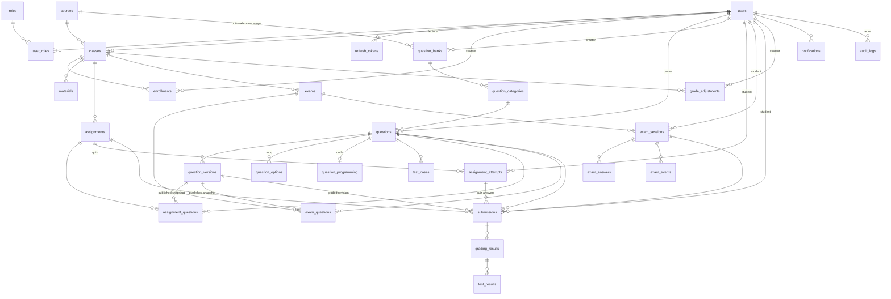

# Thiết kế CSDL — LMS (MySQL 8)

| | |
|---|---|
| Phiên bản | 1.3 — 2026-10-24 |
| Nguồn yêu cầu | `srs.md` (M1–M10, BR1–BR15) |
| Công nghệ | MySQL 8.4, InnoDB, utf8mb4, Spring Data JPA + Flyway migration |

Quy ước: PK `id BIGINT AUTO_INCREMENT`; timestamps `DATETIME` (UTC, app-level); soft-delete chỉ cho `questions` (tái sử dụng); user không xóa cứng (dùng `status='locked'`). FK mặc định `RESTRICT`.

## 1. ERD (tổng quan)



## 2. Bảng chi tiết

### 2.1 Danh tính (M1)

**users**
| Cột | Kiểu | Ghi chú |
|---|---|---|
| id | BIGINT PK AI | |
| email | VARCHAR(255) UNIQUE | NOT NULL |
| password_hash | VARCHAR(255) | argon2id |
| full_name | NVARCHAR(150) | |
| student_code | VARCHAR(20) UNIQUE NULL | sinh viên |
| phone | VARCHAR(20) NULL | liên hệ cá nhân |
| avatar_path | VARCHAR(255) NULL | đường dẫn file trong `storage/avatars/` (upload, không base64) |
| status | ENUM('active','locked') | default active |
| last_login_at | DATETIME NULL | |
| created_at / updated_at | DATETIME | |

**roles** — id TINYINT PK, name VARCHAR(30) UNIQUE ('student','lecturer','admin'), description. Seed 3 dòng.
**user_roles** — PK(user_id, student FK → users/roles).
**refresh_tokens** — id PK, user_id FK, token_hash CHAR(64) UNIQUE (SHA-256 của token), expires_at, revoked_at NULL, created_at. Index (user_id).

### 2.2 Khóa học & lớp (M2)

**courses** — id, code VARCHAR(20) UNIQUE, name NVARCHAR(200), description TEXT, created_by FK users, created_at.
**classes** — id, course_id FK, code VARCHAR(30), name NVARCHAR(200), semester VARCHAR(20) (vd '2026.1'), lecturer_id FK users, max_students INT UNSIGNED NULL (NULL = không giới hạn; BR12: không được < sĩ số hiện tại), enroll_from DATETIME NULL, enroll_until DATETIME NULL (NULL/NULL = luôn mở; enroll_until > enroll_from), room VARCHAR(50) NULL, schedule VARCHAR(100) NULL, status ENUM('active','locked') default 'active', grade_policy JSON NULL (`{"quiz":0.2,"assignment":0.3,"midterm":0.2,"final":0.3}`), created_at. UNIQUE(course_id, code); index (semester), (enroll_until).
**enrollments** — id, class_id FK, student_id FK, status ENUM('active','dropped') default active, enrolled_at, enrolled_via ENUM('lecturer','self') default 'lecturer'. UNIQUE(class_id, student_id); index (student_id).

### 2.3 Học liệu (M3)

**materials** — id, class_id FK, title NVARCHAR(200), description TEXT NULL, type ENUM('pdf','doc','slide','link','video','archive','other'), file_path VARCHAR(500) NULL (link → URL), size_bytes BIGINT default 0, uploaded_by FK, created_at. Index (class_id, created_at).

### 2.4 Ngân hàng câu hỏi (M4)

**question_banks** — id, course_id FK courses NULL UNIQUE, owner_id FK users, name VARCHAR(100), description TEXT NULL, created_by FK users, created_at. Tối đa một ngân hàng dùng chung cho mỗi học phần; hệ thống tạo khi thêm câu hỏi đầu tiên. `course_id` NULL là ngân hàng cá nhân nâng cao; có thể có nhiều ngân hàng cá nhân. Ngân hàng theo học phần được dùng chung bởi admin và giảng viên phụ trách các lớp của học phần.

**question_categories** — id, bank_id FK question_banks, name VARCHAR(100), created_by FK users, created_at. UNIQUE(bank_id, name). Mỗi ngân hàng có danh mục hệ thống “Chưa phân loại” (không đổi tên/xóa); danh mục phẳng khác là tùy chọn, dùng để nhóm theo chương/chủ đề. Không dùng chuỗi `topic` tự do để thay thế danh mục.

**questions** — id, owner_id FK users (người tạo), category_id FK question_categories NOT NULL (backend tự gán danh mục “Chưa phân loại” nếu request không chọn), type ENUM('mcq','programming'), content TEXT, topic VARCHAR(100) NULL, difficulty ENUM('easy','medium','hard') default 'medium', is_deleted BOOL default 0, created_at, updated_at. Đây là bản hiện hành trong ngân hàng; chỉnh sửa tạo nội dung cho phiên bản mới, không sửa snapshot đã được assessment xuất bản sử dụng. Index (owner_id, type), (category_id, type, difficulty, is_deleted).

**question_versions** — id, question_id FK, version_no INT, snapshot JSON, created_by FK users, created_at. UNIQUE(question_id, version_no). `snapshot` giữ toàn bộ dữ liệu cần để hiển thị/chấm phiên bản đó: type, content, options kèm đáp án đúng, starter code, ngôn ngữ/giới hạn chạy, test case theo thứ tự kèm input/expected/public/weight. Bản ghi là append-only; không cập nhật/xóa sau khi tạo.

**question_options** — id, question_id FK, content TEXT, is_correct BOOL, position INT UNSIGNED. Index (question_id).

**question_programming** — question_id PK/FK; starter_code TEXT NULL, solution_code MEDIUMTEXT NULL (lecturer verify đề), allowed_languages JSON NULL (NULL = tất cả), time_limit_ms INT UNSIGNED default 5000, memory_limit_mb INT UNSIGNED default 256.

**test_cases** — id, question_id FK, input MEDIUMTEXT, expected_output MEDIUMTEXT, is_public BOOL default 1, weight DECIMAL(5,2) default 1.0, position INT UNSIGNED. Index (question_id).

### 2.5 Bài tập (M5)

**assignments** — id, class_id FK, title NVARCHAR(200), description TEXT, category VARCHAR(20) CHECK IN ('quiz','assignment','midterm','final') default 'assignment', available_from DATETIME NULL, due_at DATETIME, allow_late BOOL default 0, late_due_at DATETIME NULL, late_penalty_percent INT UNSIGNED default 0, max_attempts INT NULL (NULL = không giới hạn), score_policy ENUM('best','last') default 'best', is_published BOOL default 0, created_by FK, created_at, updated_at. `category='quiz'` chỉ nhận câu MCQ trong v1; `max_attempts` tính theo toàn bài quiz, còn các hạng mục khác tính theo từng câu. Index (class_id, due_at).

**assignment_questions** — id, assignment_id FK, question_id FK (nguồn trong bank), question_version_id FK NULL (được ghim khi publish), points DECIMAL(6,2), position INT UNSIGNED. UNIQUE(assignment_id, question_id). Sau publish, assessment và các dòng câu hỏi/snapshot/điểm/thứ tự bất biến; thay đổi cần tạo assignment nháp mới.

**assignment_attempts** — lượt nộp **toàn bài quiz**: id, assignment_id FK, student_id FK users, attempt_no INT, is_late BOOL default 0, late_penalty_percent INT UNSIGNED, score DECIMAL(8,2), idempotency_key CHAR(36) UNIQUE, submitted_at DATETIME. UNIQUE(assignment_id, student_id, attempt_no); index (student_id, submitted_at). Chỉ tạo khi nộp quiz chính thức; tạo lượt và toàn bộ submission MCQ của lượt trong cùng transaction. Điểm lượt = tổng điểm các câu sau phạt muộn, câu không trả lời = 0.

### 2.6 Kỳ thi (M7)

**exams** — id, class_id FK, title NVARCHAR(200), grade_category ENUM('midterm','final'), rules_text TEXT, duration_minutes INT, opens_at DATETIME, closes_at DATETIME, shuffle_questions BOOL default 0, is_published BOOL default 0, created_by FK, created_at, updated_at. `grade_category` xác định kỳ thi đóng góp vào hạng mục sổ điểm nào. Sau publish, exam và nội dung assessment bất biến; muốn đổi phải tạo exam nháp mới. Index (class_id, opens_at).

**exam_questions** — id, exam_id FK, question_id FK (nguồn trong bank), question_version_id FK NULL (được ghim khi publish), points DECIMAL(6,2), position SMALLINT. UNIQUE(exam_id, question_id).

**exam_sessions** — id, exam_id FK, student_id FK, started_at, ends_at (= min(started_at + duration, closes_at), server tính), status ENUM('in_progress','submitted','auto_submitted'), submitted_at NULL, ip VARCHAR(45). UNIQUE(exam_id, student_id); **index (status, ends_at)** cho sweeper auto-submit.

**exam_answers** — id, exam_session_id FK, question_id FK, selected_option_ids JSON NULL (MCQ), code_text MEDIUMTEXT NULL (draft code), updated_at. UNIQUE(exam_session_id, question_id).

**exam_events** — id, exam_session_id FK, event ENUM('start','autosave','ws_disconnect','ws_reconnect','submit','auto_submit'), detail JSON NULL, created_at. Index (exam_session_id).

### 2.7 Nộp bài & chấm (M5/M6) ⭐

**submissions** — bảng thống nhất 2 loại bài nộp (quiz + code). Migration M5 tạo các cột assignment bên dưới; migration M7 bổ sung `exam_session_id` và ràng buộc bài nộp thuộc assignment hoặc phiên thi:
| Cột | Kiểu | Ghi chú |
|---|---|---|
| id | BIGINT PK AI | |
| student_id | FK users | |
| assignment_id | FK NULL | bài thường |
| assignment_attempt_id | FK assignment_attempts NULL | chỉ có ở quiz; gom các câu thuộc một lượt toàn bài |
| exam_session_id | FK NULL | bài thi — CHECK: ít nhất 1 trong 2 NOT NULL |
| question_id | FK questions | nộp theo từng câu |
| question_version_id | FK question_versions | phiên bản câu được giao; dùng khi đọc đề và regrade |
| type | ENUM('mcq','code') | |
| selected_option_ids | JSON NULL | MCQ |
| language | VARCHAR(20) NULL | code |
| source_code | MEDIUMTEXT NULL | code (≤16MB đủ; đường mở rộng: object storage) |
| attempt_no | INT | quiz: bằng `assignment_attempts.attempt_no`; bài khác: đếm theo (assignment, student, question); bài thi: 1 |
| status | ENUM('pending','grading','completed','failed') | code; MCQ tạo xong là completed |
| score | DECIMAL(8,2) NULL | điểm câu theo thang points |
| is_late | BOOL default 0 | |
| idempotency_key | CHAR(36) UNIQUE NULL | bài nộp từng câu; quiz lưu key ở `assignment_attempts`, các dòng câu để NULL |
| submitted_at | DATETIME | |

Index: UNIQUE(assignment_id, student_id, question_id, attempt_no); UNIQUE(assignment_attempt_id, question_id); (student_id, submitted_at); (exam_session_id). Với quiz, mọi câu trong cùng lượt dùng chung `assignment_attempt_id` và `attempt_no`, kể cả câu bỏ trống (`selected_option_ids` NULL, điểm 0); bài khác để `assignment_attempt_id` NULL. Bài thi không thuộc `assignment_attempts`.

**grading_results** — id, submission_id FK, attempt_no INT (số lần chấm, regrade ++), status ENUM('graded','failed'), total_score DECIMAL(6,2), compile_output TEXT NULL, error_message TEXT NULL, graded_at, duration_ms INT. Index (submission_id).

**test_results** — id, grading_result_id FK, test_case_position SMALLINT (vị trí trong `question_versions.snapshot` của submission), status ENUM('passed','wrong_answer','runtime_error','timeout','memory_limit','internal_error'), output TEXT (stdout truncate 64KB), time_ms INT, memory_kb INT NULL, score DECIMAL(6,2). Index (grading_result_id). Kết hợp `submission.question_version_id` + `test_case_position` để truy vết chính xác test đã dùng mà không tham chiếu test case mutable trong ngân hàng.

### 2.8 Điểm (M8)

**grade_adjustments** — id, class_id FK, student_id FK, points DECIMAL(5,2) (thang 10, âm được), reason VARCHAR(500), created_by FK, created_at. Index (class_id, student_id).

Công thức (FR-GB-02), tính từ submissions + grade_policy, KHÔNG lưu bảng riêng:
- Điểm quiz = tổng điểm câu MCQ trong từng `assignment_attempts` (câu bỏ trống = 0), rồi chọn **lượt toàn bài** theo `score_policy` best/last.
- Điểm bài không phải quiz = chọn submission best/last **riêng từng câu**, rồi cộng các điểm câu; mỗi câu có tối đa `max_attempts` lần nộp chính thức.
- Điểm kỳ thi = tổng điểm câu trong phiên thi, gán vào `exams.grade_category` (`midterm`/`final`).
- Assessment chưa publish không tính. Khi cửa sổ nộp đóng (`due_at`, hoặc `late_due_at` nếu cho nộp muộn), assessment không có bài nộp được tính 0; kỳ thi không có session/submission sau `closes_at` tính 0. Assessment có bài code đang pending/grading làm tổng lớp chưa chốt, không được coi là 0.
- Avg hạng mục = avg(điểm assessment / max điểm assessment) × 100; gồm bài tập và kỳ thi thuộc hạng mục tương ứng.
- Khi mọi assessment đã publish đóng nhận bài và mọi submission đã có kết quả, tổng % = Σ avg × trọng số → thang 10 = round(pct/10, 1), cộng adjustment.

### 2.9 Thông báo / Audit / Cấu hình (M9/M10)

**notifications** — id, user_id FK, type VARCHAR(40) ('assignment.published','submission.graded','exam.published','grade.released','material.created','enrollment.created'), title VARCHAR(200), body TEXT NULL, data JSON NULL (vd submission_id), is_read BOOL default 0, created_at. Index (user_id, is_read, created_at).

**audit_logs** — id, actor_id FK NULL (NULL = system), action VARCHAR(60) ('user.update','role.assign','grade.adjust','exam.publish','settings.update','submission.regrade'...), entity_type VARCHAR(40), entity_id BIGINT, old_value JSON, new_value JSON, ip VARCHAR(45), created_at. Index (entity_type, entity_id), (actor_id, created_at), (created_at). **Append-only.**

**system_settings** — setting_key VARCHAR(60) PK, setting_value JSON, description VARCHAR(255), updated_by FK, updated_at. Keys: `allowed_languages`, `default_time_limit_ms`, `default_memory_limit_mb`, `max_upload_mb`.

## 3. Máy trạng thái

```
Submission(code):  pending ──worker pick──▶ grading ──ok──▶ completed
                       │                      └──system error (sau retry)──▶ failed
MCQ submit:        tạo là completed (chấm đồng bộ)
ExamSession:       in_progress ──submit──▶ submitted
                       └──── hết ends_at (sweeper) ────▶ auto_submitted
```

## 4. Chiến lược hiệu năng & khối lượng

- Index nóng khớp truy vấn: gradebook đọc theo (class → assignments → submissions theo student); monitor thi đọc (exam_id, status).
- Search danh sách (FR-CRS-06): email/student_code đã UNIQUE-index; `classes(semester)`, `classes(enroll_until)` phục vụ catalog; search `full_name`/`title` dùng LIKE prefix + index thường ở quy mô môn học (không fulltext engine). Catalog đếm sĩ số bằng subquery COUNT, KHÔNG N+1.
- Bảng tăng nhanh: submissions, test_results, audit_logs, exam_events → chỉ giữ cột cần, output/log truncate 64KB, code MEDIUMTEXT.
- Điểm/số liệu tổng hợp: query + cache app-level ngắn (60s) nếu cần; v1 ưu tiên query thẳng, đo trước tối ưu.
- Charset utf8mb4 + collation utf8mb4_0900_ai_ci toàn hệ thống (tiếng Việt).
- Migration: Flyway. DB đã có Alembic schema được baseline ở version 4; DB mới chạy V1–V4. Mỗi thay đổi schema sau đó phải qua migration versioned (bắt đầu V5), cấm sửa tay.
