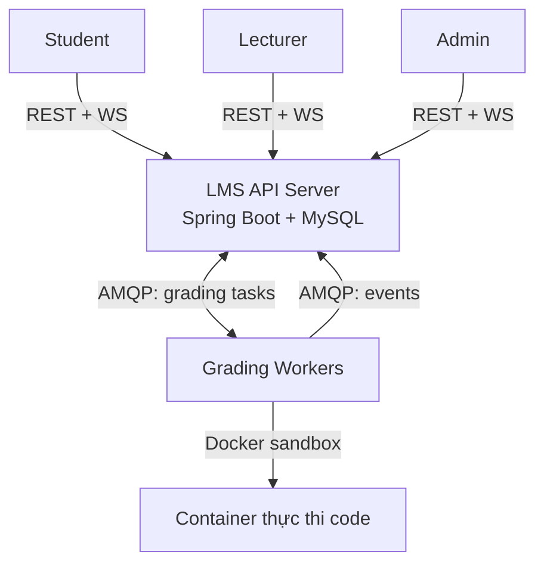

# SRS — LMS Client/Server (Môn Lập trình mạng)

| Thuộc tính | Giá trị |
|---|---|
| Phiên bản | 1.7 — 2026-10-25 |
| Trạng thái | Baseline (spec-first, chuẩn đối chiếu cho DB/API/kiến trúc/plan) |
| Nguồn требования | Subject gốc của giảng viên (English, bản gốc trong repo docs) |
| Tham khảo mở rộng | `LMS – Phân tích nghiệp vụ và kiến trúc công nghệ.md` — CHỈ tham khảo, phạm vi lấy theo Subject + tài liệu này |

---

## 1. Giới thiệu

### 1.1 Mục đích
Đặc tả yêu cầu hệ thống LMS kiến trúc Client/Server: học trực tuyến, nộp bài, thi trực tuyến, chấm điểm lập trình tự động. Là nguồn chân lý (source of truth) cho: thiết kế CSDL (`database-design.md`), hợp đồng API (`api-spec.md`), hợp đồng message (`message-contracts.md`), kiến trúc (`system-architecture.md`), lộ trình (`development-roadmap.md`).

### 1.2 Phạm vi

**Trong phạm vi (v1):**
- Quản lý tài khoản, xác thực JWT, phân quyền RBAC (student / lecturer / admin).
- Khóa học, lớp học, ghi danh, học liệu (upload/download).
- Ngân hàng câu hỏi: trắc nghiệm MCQ + lập trình (kèm test case công khai/ẩn).
- Bài tập & quiz: hạn nộp, số lần nộp, nộp muộn, chính sách chấm.
- Bài tập lập trình: nộp code → hàng đợi RabbitMQ → worker chấm trong sandbox Docker cô lập → kết quả realtime qua WebSocket.
- Kỳ thi: lịch thi, phiên thi, đồng hồ server, tự lưu bài, tự động nộp, giám sát của giảng viên.
- Sổ điểm: trọng số theo hạng mục, điều chỉnh thủ công, xuất CSV.
- Thông báo in-app; nhật ký kiểm toán; cấu hình hệ thống; thống kê quản trị.

**Ngoài phạm vi (v1) — ghi rõ để không bị "scope creep":**
- Thanh toán, video streaming quy mô lớn, mobile native, SSO, email, i18n, chống gian lận bằng AI.
- Redis, replica MySQL, object storage S3/MinIO, Kubernetes, Prometheus/Grafana/ELK.
→ Các mục này nằm ở "Đường mở rộng" trong `system-architecture.md`, KHÔNG xây v1.

### 1.3 Định nghĩa & viết tắt
- **RBAC**: Role-Based Access Control. **JWT**: JSON Web Token. **MCQ**: Multiple Choice Question.
- **Sandbox**: môi trường thực thi code không tin cậy, cô lập tài nguyên + không mạng.
- **Worker**: tiến trình consumer tiêu thụ tác vụ chấm từ RabbitMQ.
- **DLQ**: Dead-Letter Queue — nơi chứa tác vụ thất bại sau khi retry.
- **CCU**: Concurrent Users. **MoSCoW**: Must/Should/Could/Won't.

### 1.4 Actors

| Actor | Mô tả | Mục tiêu |
|---|---|---|
| Student | Người học | Học, làm bài, nộp bài, xem kết quả/điểm |
| Lecturer | Giảng viên | Quản lý lớp, ngân hàng câu hỏi, bài tập, kỳ thi, điểm |
| Admin | Quản trị | Quản lý người dùng, cấu hình, giám sát hoạt động |
| Grading Worker | Actor hệ thống | Biên dịch, thực thi sandbox, chấm điểm tự động |

## 2. Tổng quan hệ thống

### 2.1 Sơ đồ ngữ cảnh

### 2.2 Nền tảng công nghệ
Frontend dùng React + TypeScript (SPA); backend dùng Java + Spring Boot. MySQL lưu dữ liệu; REST API xử lý nghiệp vụ; WebSocket chỉ đẩy trạng thái/kết quả chấm bài; RabbitMQ phân phối tác vụ chấm tới worker cô lập. Thay đổi nền tảng này theo quyết định của chủ dự án; các yêu cầu nghiệp vụ và hợp đồng API vẫn giữ nguyên.

### 2.3 Giả định
- Triển khai demo: Docker Compose local, 1 instance API, N worker (`--scale worker=2` demo "distributed workers").
- Tài khoản demo local của student, lecturer và admin dùng chung mật khẩu `Demo@12345` để thuận tiện trình diễn; không dùng thông tin đăng nhập demo khi triển khai thật.
- Quy mô mục tiêu: 100–300 CCU, burst nộp bài ~100 lượt cuối giờ thi (hàng đợi hấp thụ).
- Mỗi thí sinh 1 phiên thi / kỳ thi (v1).

---

## 3. Yêu cầu chức năng

Ưu tiên MoSCoW: **M** = bắt buộc v1, **S** = nên có v1, **C/W** = defer.

### M1 — Xác thực & người dùng
| ID | Ưu tiên | Yêu cầu |
|---|---|---|
| FR-AUTH-01 | M | Đăng nhập email + mật khẩu (argon2id) → access token (15m) + refresh token (7d, rotate). Sai 5 lần liên tiếp/khóa tạm 15 phút theo tài khoản |
| FR-AUTH-02 | M | Refresh → cấp cặp mới + revoke cũ; logout revoke refresh |
| FR-AUTH-03 | M | Hồ sơ cá nhân: GET /auth/me; sửa họ tên, SĐT; đổi mật khẩu; **upload ảnh đại diện** (jpg/png/webp ≤2MB, lưu file trong `storage/avatars/<user_id>`, không lưu binary trong DB) |
| FR-AUTH-04 | M | RBAC 3 role; user có thể có nhiều role; kiểm tra quyền ở tầng service (không chỉ UI) |
| FR-AUTH-05 | M | Admin: CRUD user, gán role, import CSV hàng loạt, reset mật khẩu, khóa/mở tài khoản (kèm lý do → audit; khóa → revoke toàn bộ refresh token). **Chi tiết user**: roles, lớp đang học (nếu SV), lớp đang dạy (nếu GV); filter theo role/trạng thái, search tên/email/mã SV |
| FR-AUTH-06 | S | WebSocket xác thực bằng token khi kết nối |
| FR-AUTH-07 | S | Admin (nên có): import CSV có bước **preview + validate trước commit** (báo trùng email/mã SV từng dòng, file mẫu), xuất CSV danh sách user, ép đăng xuất 1 user bất kỳ (revoke sessions) |

### M2 — Học phần & lớp học phần
| ID | Ưu tiên | Yêu cầu |
|---|---|---|
| FR-CRS-01 | M | Admin quản lý CRUD học phần (course) và CRUD lớp học phần thuộc học phần, học kỳ; admin phân một giảng viên phụ trách khi tạo/sửa lớp. Lecturer chỉ xem và quản lý nghiệp vụ của các lớp được phân công, không tạo/sửa/xóa học phần hoặc lớp. Thuộc tính lớp: **sĩ số tối đa** `max_students` (NULL = không giới hạn), **khung giờ ghi danh** `enroll_from`/`enroll_until`, phòng học, lịch học (text), trạng thái `active`/`locked` |
| FR-CRS-02 | M | Xếp sinh viên vào lớp do nhà trường quản lý: admin có thể thêm/xóa ở mọi lớp; lecturer chỉ quản lý danh sách lớp mình phụ trách. Có thể tìm sinh viên active chưa thuộc lớp theo tên/mã SV/email, xem gợi ý và chọn nhiều người; hoặc nhập CSV có xem trước. Không hỗ trợ nhập định danh đơn lẻ qua form hoặc dán danh sách. Lớp giới hạn sĩ số, admin được vượt giới hạn. Sinh viên chỉ xem lớp đã được xếp, không tự ghi danh/rời lớp. Xóa chuyển enrollment sang `dropped`, giữ lịch sử |
| FR-CRS-03 | M | Kiểm soát truy cập theo ghi danh (xem BR2) |
| FR-CRS-04 | M | Sinh viên xem danh sách lớp đã được xếp và học liệu/bài tập tương ứng; không hiển thị catalog lớp mở để tự ghi danh |
| FR-CRS-05 | S | Import CSV danh sách lớp hỗ trợ tải file mẫu, xem trước sinh viên nhận diện được, báo dòng lỗi/trùng và xác nhận nhập |
| FR-CRS-06 | M | Danh sách (courses, classes, lớp của tôi, sinh viên lớp, học liệu) hỗ trợ **search + phân trang + sort** theo quy ước chung api-spec |

Giao diện admin có khu quản lý học phần và khu quản lý lớp riêng: từ học phần có hành động **Mở lớp và phân công giảng viên**; ở danh sách lớp hiện giảng viên phụ trách và có hành động **Đổi giảng viên**. Giao diện giảng viên tập trung vào danh sách lớp được phân công và đường vào lớp, không hiển thị thao tác quản trị.

### M3 — Học liệu
| ID | Ưu tiên | Yêu cầu |
|---|---|---|
| FR-MAT-01 | M | Lecturer upload tệp (≤100MB: pdf/doc/slide/zip) hoặc link; tiêu đề + mô tả + phân loại |
| FR-MAT-02 | M | Student xem danh sách + tải về theo lớp |
| FR-MAT-03 | S | Sửa metadata / xóa học liệu |

### M4 — Ngân hàng câu hỏi
| ID | Ưu tiên | Yêu cầu |
|---|---|---|
| FR-QB-01 | M | Giảng viên được phân công lớp của học phần có thể tạo nhiều ngân hàng câu hỏi trong học phần đó; mỗi ngân hàng có chủ sở hữu, phạm vi `private` hoặc `shared`, và danh mục “Chưa phân loại” mặc định. Ngân hàng cũ không gắn học phần được giữ để tương thích dữ liệu. |
| FR-QB-02 | M | CRUD câu hỏi lập trình: đề bài, starter code, ngôn ngữ, giới hạn thời gian/bộ nhớ; thuộc một ngân hàng của học phần và danh mục mặc định/tự chọn. Ngân hàng cá nhân cũ vẫn đọc và dùng được để tương thích dữ liệu. |
| FR-QB-03 | M | CRUD test case: input, expected output, công khai/ẩn, trọng số, thứ tự |
| FR-QB-04 | M | Tìm/lọc theo ngân hàng, danh mục, nội dung, loại/chủ đề/độ khó. Chủ ngân hàng được sửa; giảng viên được phân công cùng học phần chỉ xem và dùng ngân hàng `shared`, trừ khi được cấp quyền `edit`; quyền `view`/`edit` có thể cấp cho từng giảng viên. Ngân hàng `private` chỉ chủ sở hữu và người được cấp quyền truy cập. Câu hỏi tái sử dụng cho nhiều bài. Admin chỉ giám sát và xử lý đặc biệt, không tạo nội dung chuyên môn thường ngày. |
| FR-QB-05 | S | Lecturer chạy thử solution mẫu để kiểm tra đề |
| FR-QB-06 | M | Mỗi lần xuất bản bài tập/kỳ thi phải ghim nội dung và phiên bản các câu hỏi, lựa chọn/đáp án, giới hạn code, test case, điểm và thứ tự. Sửa ngân hàng sau đó không đổi assessment đã xuất bản; muốn đổi nội dung/cấu trúc đề phải tạo bản nháp mới. Giảng viên được điều chỉnh metadata và lịch đã xuất bản theo FR-ASG-07; mọi thay đổi được audit |
| FR-QB-07 | M | Nhập hàng loạt câu MCQ từ CSV vào danh mục đã chọn; nếu không chọn danh mục thì dùng “Chưa phân loại”. Có file mẫu, xem trước và báo lỗi/trùng từng dòng trước khi xác nhận. CSV v1 không nhập câu lập trình/test case |

### M5 — Bài tập & Quiz
| ID | Ưu tiên | Yêu cầu |
|---|---|---|
| FR-ASG-01 | M | Giảng viên tạo đề từ câu hỏi trong ngân hàng mình được phép dùng, chọn một hoặc nhiều lớp được phân công trong cùng học phần; mỗi lớp nhận một bản bài riêng để theo dõi điểm và hạn nộp. Giảng viên đặt điểm/thứ tự/hạn nộp rồi xuất bản; khi xuất bản cố định danh sách câu, phiên bản câu hỏi, điểm và thứ tự. Bài có hạng mục `quiz` chỉ gồm câu MCQ trong v1. Admin không tạo/xuất bản đề thường ngày. |
| FR-ASG-02 | M | Chính sách: available_from, due_at, max_attempts (NULL = không giới hạn), nộp muộn (late_due_at + phạt %), score_policy (best/last), hạng mục điểm (quiz/assignment/midterm/final). Các mốc thời gian được chuẩn hóa và kiểm tra theo UTC; giao diện nhận/hiển thị giờ địa phương. Với quiz, lượt và best/last áp dụng cho **toàn bài**; với bài khác, áp dụng cho **từng câu** |
| FR-ASG-03 | M | Làm quiz: nộp đáp án của cả bài trong một request có Idempotency-Key; câu bỏ trống được 0 điểm; server lưu một lượt quiz cùng các đáp án trong một transaction, chấm MCQ đồng bộ và trả điểm của lượt ngay |
| FR-ASG-04 | M | Server kiểm tra hạn nộp + lượt nộp theo BR3; quá hạn từ chối hoặc đánh dấu muộn trừ %. Chỉ nộp chính thức mới tính lượt; mở đề và Run thử test công khai không tính lượt |
| FR-ASG-05 | M | Student xem lịch sử lượt quiz hoặc lần nộp từng câu, kết quả từng test công khai, điểm |
| FR-ASG-06 | S | Lecturer xem danh sách bài nộp theo bài/lớp |
| FR-ASG-07 | M | Sau khi xuất bản, giảng viên phụ trách vẫn có thể sửa tiêu đề, mô tả, thời điểm mở, hạn nộp và chính sách nộp muộn; nhập lý do và ghi audit before/after. Không được thay hạng mục, câu hỏi, phiên bản câu hỏi, điểm, thứ tự, số lượt hoặc cách tính điểm. Thay đổi chỉ ảnh hưởng các lượt nộp tiếp theo; các bài đã nộp giữ nguyên dữ liệu và điểm đã ghim |

### M6 — Chấm bài lập trình tự động ⭐
| ID | Ưu tiên | Yêu cầu |
|---|---|---|
| FR-GRD-01 | M | Nộp code (ngôn ngữ trong danh sách cho phép) → validate → lưu submission `pending` → publish RabbitMQ → **202 Accepted** + submission_id |
| FR-GRD-02 | M | Idempotency-Key chống nộp trùng (unique index) |
| FR-GRD-03 | M | Worker: biên dịch → chạy từng test trong sandbox (không mạng, giới hạn CPU/bộ nhớ/PID/thời gian/đầu ra) → so sánh → tính điểm theo trọng số test |
| FR-GRD-04 | M | Trạng thái `pending → grading → completed | failed`; hiển thị lỗi biên dịch, stdout/stderr (cắt ngắn), trạng thái từng test; test ẩn chỉ trả pass/fail (BR4) |
| FR-GRD-05 | M | WS đẩy trạng thái + kết quả chấm realtime tới sinh viên |
| FR-GRD-06 | S | Nút "Run" chạy thử với test công khai, không ghi điểm |
| FR-GRD-07 | S | Lecturer regrade — tạo kết quả mới, giữ lịch sử (BR8); lecturer thấy cả test ẩn |
| FR-GRD-08 | M | Retry có giới hạn → DLQ khi lỗi hệ thống; submission `failed` + thông báo |

Triển khai phần API M6: lưu bài nộp và job outbox trong cùng transaction; publisher dùng confirm và retry khi broker chưa sẵn sàng. Worker đọc code/snapshot đã ghim từ DB, gửi kết quả theo `docs/message-contracts.md` v2; API kiểm tra kết quả, tính điểm theo trọng số/phạt muộn, lưu transaction rồi mới ACK và phát WebSocket. Worker mẫu tắt listener để giữ job trong queue cho tới khi sandbox ở phần 2 được triển khai. Run thử, regrade và thực thi sandbox thuộc phần tiếp theo.

### M7 — Kỳ thi
| ID | Ưu tiên | Yêu cầu |
|---|---|---|
| FR-EXM-01 | M | Tạo kỳ thi: tìm/chọn câu từ ngân hàng và danh mục, hạng mục điểm `midterm` hoặc `final`, thời lượng, opens_at/closes_at, nội dung quy chế, shuffle, xuất bản. Khi xuất bản, cố định danh sách câu, phiên bản câu hỏi, điểm và thứ tự |
| FR-EXM-02 | M | Vào thi trong [opens_at, closes_at): xác nhận quy chế → tạo phiên; `ends_at = min(started_at + duration, closes_at)`; 1 phiên/thí sinh |
| FR-EXM-03 | M | Đề chỉ hiển thị sau khi phiên bắt đầu (BR9); shuffle thứ tự câu theo thí sinh nếu bật |
| FR-EXM-04 | M | Thời gian chuẩn do server; client hiển thị đếm ngược từ `remaining_seconds` định kỳ |
| FR-EXM-05 | M | Tự lưu bài (autosave ~15s / debounce): đáp án MCQ + draft code |
| FR-EXM-06 | M | Tự động nộp khi hết giờ (server sweeper, không phụ thuộc client): chấm MCQ, code vào queue **ưu tiên cao** |
| FR-EXM-07 | M | Nộp sớm thủ công; sau ends_at từ chối |
| FR-EXM-08 | S | Lecturer giám sát trực tiếp: danh sách phiên (trạng thái, đã nộp), poll 5s |
| FR-EXM-09 | S | Ghi log sự kiện phiên thi: start, autosave, mất kết nối, reconnect, submit |

### M8 — Sổ điểm
| ID | Ưu tiên | Yêu cầu |
|---|---|---|
| FR-GB-01 | M | Chính sách điểm theo lớp: trọng số hạng mục (quiz/assignment/midterm/final), validate tổng 100% |
| FR-GB-02 | M | Mỗi bài tập và kỳ thi đã xuất bản thuộc một hạng mục điểm; kỳ thi được gán `midterm` hoặc `final`. Điểm hạng mục là trung bình các assessment đã đóng sau khi chuẩn hóa theo điểm tối đa; bài không nộp sau khi hết hạn/cửa sổ nộp tính 0. Tổng chỉ được chốt khi mọi assessment đã xuất bản đóng nhận bài và mọi submission đã chấm xong; trong lúc còn bài chưa chấm, trạng thái tổng là `pending`, không coi submission đang chấm là 0 |
| FR-GB-03 | M | Lecturer: bảng điểm lớp (sinh viên × bài + tổng), xuất CSV |
| FR-GB-04 | M | Student: điểm cá nhân theo lớp |
| FR-GB-05 | M | Điều chỉnh thủ công (cộng/trừ + lý do) → ghi audit (BR7) |
| FR-GB-06 | S | Tiến độ học tập: % bài tập đã nộp theo lớp |
| FR-GB-07 | M | Điểm từng assessment hiển thị khi đã chấm; trạng thái và tổng điểm cho biết đang chờ chấm hay đã chốt. Khi tất cả assessment trong lớp đã đóng và chấm xong, hệ thống tính và hiển thị tổng điểm cuối theo FR-GB-02 |

### M9 — Thông báo
| ID | Ưu tiên | Yêu cầu |
|---|---|---|
| FR-NTF-01 | M | Thông báo in-app: bài mới, kết quả chấm, kỳ thi mở và điểm công bố |
| FR-NTF-02 | M | Danh sách thông báo, lọc trạng thái, đánh dấu một hoặc tất cả đã đọc qua REST |

### M10 — Quản trị & giám sát
| ID | Ưu tiên | Yêu cầu |
|---|---|---|
| FR-ADM-01 | M | Cấu hình hệ thống (key-value): ngôn ngữ cho phép, giới hạn mặc định, giới hạn upload |
| FR-ADM-02 | M | Xem nhật ký kiểm toán (lọc actor/hành động/đối tượng/thời gian) |
| FR-ADM-03 | M | Thống kê: số user/lớp/submission theo ngày, độ sâu hàng đợi, độ trễ chấm trung bình |

---

## 4. Quy trình nghiệp vụ chính

### A — Nộp & chấm bài lập trình
1. Lecturer tạo bài tập, gắn câu hỏi lập trình + test case, đặt chính sách.
2. Student viết code (Monaco editor), có thể Run thử test công khai.
3. Student nộp → server kiểm tra quyền/hạn/lượt → lưu `pending` (transaction) → publish `grading.submit` lên RabbitMQ (priority thường) → 202 + submission_id.
4. Worker consume → tải code + test từ DB → biên dịch (lỗi → `compile_error`, trả kết quả) → chạy từng test trong container sandbox one-shot.
5. So sánh output → tính điểm theo trọng số → ghi grading_result + test_results → ack message.
6. Worker publish `events.ws` → API broadcast WS → UI cập nhật live; ghi notification.

### B — Kỳ thi
1. Lecturer tạo + publish kỳ thi (đề, thời lượng, lịch, quy chế).
2. Đến giờ: student xác nhận quy chế → server tạo session, tính ends_at.
3. Client đếm ngược theo `remaining_seconds` từ server; autosave định kỳ.
4. Hết giờ: sweeper server đóng phiên, auto-submit: chấm MCQ từ đáp án đã lưu, tạo submission code priority cao → pipeline A.
5. Lecturer xem kết quả, xử lý phúc khảo (regrade/điều chỉnh — có audit).

### C — Điểm tổng kết
Điểm từng bài (best/last theo chính sách) và kỳ thi đã chấm → chuẩn hóa theo điểm tối đa → trung bình theo hạng mục (quiz/assignment/midterm/final) → × trọng số lớp → tổng % → thang 10 (+ điều chỉnh thủ công có audit). Assessment quá hạn/cửa sổ thi đã đóng mà không có bài nộp tính 0. Nếu còn submission chưa chấm, tổng ở trạng thái `pending`; chỉ chốt sau khi mọi assessment đã xuất bản đóng và bài nộp đã có kết quả.

### D — Làm quiz
1. Student mở quiz đã xuất bản trong khung thời gian cho phép; thao tác xem đề không tính lượt.
2. Student nộp đáp án MCQ của cả bài một lần; câu bỏ trống tính 0 điểm. Server kiểm tra hạn và `max_attempts` theo **số lượt quiz** đã nộp.
3. Server tạo một lượt quiz và các submission theo câu trong cùng transaction, chấm đồng bộ, trả điểm lượt. Nộp lại tạo lượt mới; Idempotency-Key trùng trả lượt cũ và không tăng bộ đếm.

---

## 5. Quy tắc nghiệp vụ

| ID | Quy tắc |
|---|---|
| BR1 | User có ≥1 role; quyền giới hạn theo role VÀ phạm vi lớp (enrollment) |
| BR2 | Student chỉ truy cập khóa học/bài tập/kỳ thi của lớp mình ghi danh |
| BR3 | Max attempts, hạn nộp, phạt nộp muộn cấu hình từng bài; server kiểm soát kể cả khi nhiều request nộp đồng thời. `max_attempts` NULL = không giới hạn. Với `category=quiz`, 1 request nộp cả bài = 1 lượt, tính `best/last` trên **tổng điểm từng lượt**. Với bài không phải quiz, mỗi lần nộp một câu = 1 lượt **của câu đó**, tính `best/last` riêng cho từng câu rồi cộng điểm câu thành điểm bài. Run thử và xem đề không tính lượt. Kỳ thi dùng 1 phiên/thí sinh theo M7, không dùng `max_attempts` của bài tập |
| BR4 | Test ẩn KHÔNG bao giờ trả input/expected về client; chỉ pass/fail |
| BR5 | Thời gian thi tính bởi server; nộp sau ends_at bị từ chối |
| BR6 | Điểm câu lập trình = điểm câu × (Σ trọng số test đạt / Σ trọng số test); vượt thời gian/bộ nhớ = không đạt |
| BR7 | Mọi thay đổi điểm, đề thi, cấu hình, phân quyền → audit log (ai, khi nào, before/after) |
| BR8 | Submission bất biến (không sửa/xóa); regrade tạo grading_result mới gắn cùng submission và dùng đúng phiên bản câu hỏi/test case mà submission đã tham chiếu |
| BR9 | Đề thi chỉ hiển thị sau thời điểm bắt đầu phiên của thí sinh đó |
| BR10 | Code sinh viên chỉ chạy trong sandbox: không mạng, giới hạn CPU/RAM/PID/thời gian/đầu ra, filesystem chỉ đọc |
| BR11 | Admin/lecturer được xếp sinh viên bất kể `enroll_from`/`enroll_until`; lecturer chỉ được thêm/xóa trong lớp mình phụ trách. Khi đạt `max_students`, thêm sinh viên trả `CLASS_FULL`; chỉ admin được vượt sĩ số. Import CSV validate từng dòng, không tạo ghi danh trùng, và kiểm tra lại các điều kiện ở thời điểm xác nhận |
| BR12 | Sửa `max_students` không được nhỏ hơn sĩ số hiện tại; nếu cả hai đầu có, `enroll_until` > `enroll_from`; thay đổi sĩ số/khung giờ/trạng thái lớp → audit |
| BR13 | Lớp `locked`: chặn ghi danh mới, sinh viên không truy cập nội dung lớp (học liệu) |
| BR14 | Khi xuất bản assessment, hệ thống lưu snapshot bất biến của câu hỏi và phiên bản nội dung/đáp án/test case/giới hạn chấm, điểm tối đa và thứ tự. Sửa hoặc xóa câu trong ngân hàng không thay đổi assessment đã xuất bản; muốn đổi nội dung/cấu trúc phải tạo assessment nháp mới. Giảng viên phụ trách có thể điều chỉnh metadata và lịch theo FR-ASG-07, phải nhập lý do và ghi audit. Bài nộp và mọi lần chấm lại giữ tham chiếu snapshot cùng chính sách đã ghim lúc nộp |
| BR15 | Chỉ assessment đã xuất bản được tính điểm. Assessment không có submission sau khi hạn/cửa sổ đóng có điểm 0. Submission code đang `pending`/`grading` không tính là 0; tổng điểm lớp ở trạng thái `pending` cho tới khi tất cả assessment đã xuất bản đóng và các submission của chúng đã chấm xong |

## 6. Yêu cầu phi chức năng (đúng quy mô môn học)

| Nhóm | Yêu cầu |
|---|---|
| Hiệu năng | API thường p95 < 500ms (môi trường demo); từ nộp đến bắt đầu chấm < 5s khi rảnh |
| FE performance | Search phía client **debounce ≥300ms**, chỉ gọi API khi ≥2 ký tự; hủy request đang chạy khi thay đổi filter (abort); phân trang server-side (không load all); list dùng skeleton loading; sort/filter đổi URL state để back/forward giữ ngữ cảnh |
| Chịu tải | 100–300 CCU; burst ~100 submission cuối giờ thi hấp thụ bằng queue |
| Bảo mật | TLS qua nginx (profile prod), argon2id, JWT ngắn hạn + refresh rotate, RBAC tầng service, ORM tham số hóa, validate đầu vào, CORS chặt, rate limit login, sandbox cô lập (BR10) |
| Tin cậy | Manual ack sau khi ghi DB, idempotency nộp bài, retry 3 lần → DLQ, transaction khi nộp bài/đóng phiên thi, mysqldump định kỳ |
| Mở rộng | API stateless; worker scale ngang `--scale worker=N`; đường mở rộng ghi trong `system-architecture.md` |
| Kiểm toán | Audit log mọi thao tác nhạy cảm, không sửa/xóa |
| Dùng được | Responsive desktop/tablet, tiếng Việt |

## 7. Traceability — Subject → FR

| Câu Subject | FR tương ứng |
|---|---|
| S1 accounts/auth/roles/courses/classes/materials | FR-AUTH-*, FR-CRS-*, FR-MAT-* |
| S2 assignments/question banks/exams/schedules/grading policies | FR-QB-*, FR-ASG-*, FR-EXM-01, FR-GB-01 |
| S3 submissions/compile/execute isolated/test cases/scores | FR-GRD-* |
| S4 concurrent exams/submission queues/distributed workers | FR-EXM-04..08, FR-GRD-01/03/08 |
| S5 records/grades/histories/audit logs | FR-ASG-05, FR-GB-*, FR-ADM-02, BR8 |
| S6 APIs + notifications | Toàn bộ api-spec.md, FR-NTF-*, FR-GRD-05 |
| C1 access courses/materials/progress | FR-MAT-02, FR-GB-06 |
| C2 quizzes/code editor/submission | FR-ASG-03, FR-GRD-01 |
| C3 display errors/test results/scores/status | FR-GRD-04 |
| C4 exam sessions/countdown/rules | FR-EXM-02..07 |
| C5 lecturers manage | FR-QB/ASG/EXM/GB-* |
| C6 admins interfaces | FR-ADM-*, FR-AUTH-05 |
| A1–A4 stack REST/WS/RabbitMQ/scalability | system-architecture.md |

## 8. Câu hỏi mở
- Deadline & làm một mình hay nhóm (ảnh hưởng có cắt thêm Should không)?

*(Đã chốt: ngôn ngữ chấm v1 = Python, C, C++, Java — chi tiết `system-architecture.md` §6.)*
