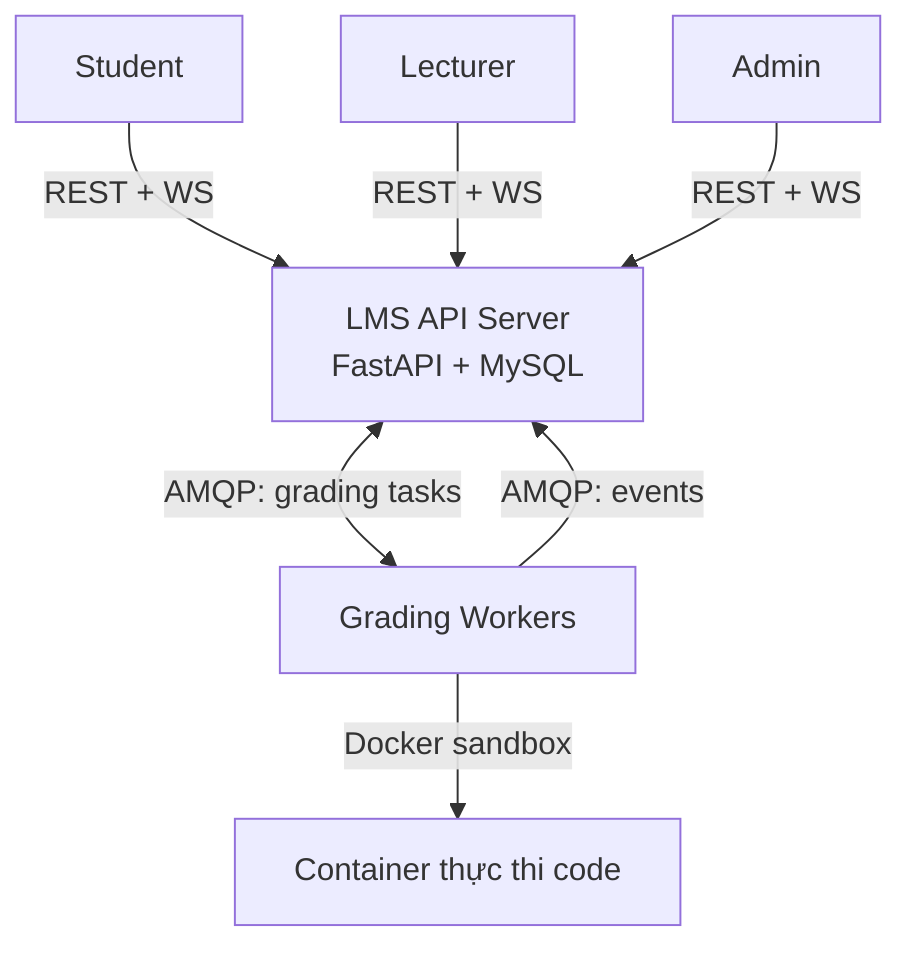

# SRS — LMS Client/Server (Môn Lập trình mạng)

| Thuộc tính | Giá trị |
|---|---|
| Phiên bản | 1.0 — 2026-10-20 |
| Trạng thái | Baseline (spec-first, chuẩn đối chiếu cho DB/API/kiến trúc/plan) |
| Nguồn требования | Subject gốc của giảng viên (English, bản gốc trong repo docs) |
| Tham khảo mở rộng | `LMS – Phân tích nghiệp vụ và kiến trúc công nghệ.md` — CHỈ tham khảo, phạm vi lấy theo Subject + tài liệu này |

---

## 1. Giới thiệu

### 1.1 Mục đích
Đặc tả yêu cầu hệ thống LMS kiến trúc Client/Server: học trực tuyến, nộp bài, thi trực tuyến, chấm điểm lập trình tự động. Là nguồn chân lý (source of truth) cho: thiết kế CSDL (`database-design.md`), hợp đồng API (`api-spec.md`), hợp đồng message (`message-contracts.md`), kiến trúc (`system-architecture.md`), lộ trình (`development-roadmap.md`).

### 1.2 Phạm vi

**Trong phạm vi (v1):**
- Quản lý tài khoản, xác thực JWT, phân quyền RBAC (student / lecturer / admin).
- Khóa học, lớp học, ghi danh, học liệu (upload/download).
- Ngân hàng câu hỏi: trắc nghiệm MCQ + lập trình (kèm test case công khai/ẩn).
- Bài tập & quiz: hạn nộp, số lần nộp, nộp muộn, chính sách chấm.
- Bài tập lập trình: nộp code → hàng đợi RabbitMQ → worker chấm trong sandbox Docker cô lập → kết quả realtime qua WebSocket.
- Kỳ thi: lịch thi, phiên thi, đồng hồ server, tự lưu bài, tự động nộp, giám sát của giảng viên.
- Sổ điểm: trọng số theo hạng mục, điều chỉnh thủ công, xuất CSV.
- Thông báo in-app realtime; nhật ký kiểm toán; cấu hình hệ thống; thống kê quản trị.

**Ngoài phạm vi (v1) — ghi rõ để không bị "scope creep":**
- Thanh toán, video streaming quy mô lớn, mobile native, SSO, email, i18n, chống gian lận bằng AI.
- Redis, replica MySQL, object storage S3/MinIO, Kubernetes, Prometheus/Grafana/ELK.
→ Các mục này nằm ở "Đường mở rộng" trong `system-architecture.md`, KHÔNG xây v1.

### 1.3 Định nghĩa & viết tắt
- **RBAC**: Role-Based Access Control. **JWT**: JSON Web Token. **MCQ**: Multiple Choice Question.
- **Sandbox**: môi trường thực thi code không tin cậy, cô lập tài nguyên + không mạng.
- **Worker**: tiến trình consumer tiêu thụ tác vụ chấm từ RabbitMQ.
- **DLQ**: Dead-Letter Queue — nơi chứa tác vụ thất bại sau khi retry.
- **CCU**: Concurrent Users. **MoSCoW**: Must/Should/Could/Won't.

### 1.4 Actors

| Actor | Mô tả | Mục tiêu |
|---|---|---|
| Student | Người học | Học, làm bài, nộp bài, xem kết quả/điểm |
| Lecturer | Giảng viên | Quản lý lớp, ngân hàng câu hỏi, bài tập, kỳ thi, điểm |
| Admin | Quản trị | Quản lý người dùng, cấu hình, giám sát hoạt động |
| Grading Worker | Actor hệ thống | Biên dịch, thực thi sandbox, chấm điểm tự động |

## 2. Tổng quan hệ thống

### 2.1 Sơ đồ ngữ cảnh

### 2.2 Ràng buộc công nghệ (Subject lock — không thay đổi)
React/Next.js (frontend) · Python (backend) · MySQL (lưu trữ) · REST API · WebSocket · RabbitMQ phân phối chấm bài tới worker cô lập.

### 2.3 Giả định
- Triển khai demo: Docker Compose local, 1 instance API, N worker (`--scale worker=2` demo "distributed workers").
- Quy mô mục tiêu: 100–300 CCU, burst nộp bài ~100 lượt cuối giờ thi (hàng đợi hấp thụ).
- Mỗi thí sinh 1 phiên thi / kỳ thi (v1).

---

## 3. Yêu cầu chức năng

Ưu tiên MoSCoW: **M** = bắt buộc v1, **S** = nên có v1, **C/W** = defer.

### M1 — Xác thực & người dùng
| ID | Ưu tiên | Yêu cầu |
|---|---|---|
| FR-AUTH-01 | M | Đăng nhập email + mật khẩu (argon2id) → access token (15m) + refresh token (7d, rotate). Sai 5 lần liên tiếp/khóa tạm 15 phút theo tài khoản |
| FR-AUTH-02 | M | Refresh → cấp cặp mới + revoke cũ; logout revoke refresh |
| FR-AUTH-03 | M | GET /auth/me; đổi thông tin cá nhân, đổi mật khẩu |
| FR-AUTH-04 | M | RBAC 3 role; user có thể có nhiều role; kiểm tra quyền ở tầng service (không chỉ UI) |
| FR-AUTH-05 | M | Admin: CRUD user, gán role, import CSV hàng loạt, reset mật khẩu, khóa/mở tài khoản |
| FR-AUTH-06 | S | WebSocket xác thực bằng token khi kết nối |

### M2 — Khóa học & lớp học
| ID | Ưu tiên | Yêu cầu |
|---|---|---|
| FR-CRS-01 | M | CRUD khóa học (lecturer/admin); CRUD lớp học thuộc khóa học, học kỳ, giảng viên phụ trách |
| FR-CRS-02 | M | Ghi danh: thêm/xóa sinh viên (lẻ + bulk), sinh viên xem lớp đã ghi danh |
| FR-CRS-03 | M | Kiểm soát truy cập theo ghi danh (xem BR2) |

### M3 — Học liệu
| ID | Ưu tiên | Yêu cầu |
|---|---|---|
| FR-MAT-01 | M | Lecturer upload tệp (≤100MB: pdf/doc/slide/zip) hoặc link; tiêu đề + mô tả + phân loại |
| FR-MAT-02 | M | Student xem danh sách + tải về theo lớp |
| FR-MAT-03 | S | Sửa metadata / xóa học liệu |

### M4 — Ngân hàng câu hỏi
| ID | Ưu tiên | Yêu cầu |
|---|---|---|
| FR-QB-01 | M | CRUD câu hỏi MCQ (nội dung, ≥2 lựa chọn, 1 đáp án đúng v1), chủ đề, độ khó |
| FR-QB-02 | M | CRUD câu hỏi lập trình: đề bài, starter code, ngôn ngữ, giới hạn thời gian/bộ nhớ |
| FR-QB-03 | M | CRUD test case: input, expected output, công khai/ẩn, trọng số, thứ tự |
| FR-QB-04 | M | Lọc theo loại/chủ đề/độ khó; câu hỏi tái sử dụng cho nhiều bài |
| FR-QB-05 | S | Lecturer chạy thử solution mẫu để kiểm tra đề |

### M5 — Bài tập & Quiz
| ID | Ưu tiên | Yêu cầu |
|---|---|---|
| FR-ASG-01 | M | Tạo bài tập trong lớp: gắn câu hỏi từ bank, điểm từng câu, thứ tự, xuất bản |
| FR-ASG-02 | M | Chính sách: available_from, due_at, max_attempts, nộp muộn (late_due_at + phạt %), score_policy (best/last), hạng mục điểm (quiz/assignment/midterm/final) |
| FR-ASG-03 | M | Làm quiz: nộp đáp án MCQ → chấm đồng bộ, trả điểm ngay |
| FR-ASG-04 | M | Server kiểm tra hạn nộp + lượt nộp; quá hạn từ chối hoặc đánh dấu muộn trừ % |
| FR-ASG-05 | M | Student xem lịch sử nộp, kết quả từng test công khai, điểm |
| FR-ASG-06 | S | Lecturer xem danh sách bài nộp theo bài/lớp |

### M6 — Chấm bài lập trình tự động ⭐
| ID | Ưu tiên | Yêu cầu |
|---|---|---|
| FR-GRD-01 | M | Nộp code (ngôn ngữ trong danh sách cho phép) → validate → lưu submission `pending` → publish RabbitMQ → **202 Accepted** + submission_id |
| FR-GRD-02 | M | Idempotency-Key chống nộp trùng (unique index) |
| FR-GRD-03 | M | Worker: biên dịch → chạy từng test trong sandbox (không mạng, giới hạn CPU/bộ nhớ/PID/thời gian/đầu ra) → so sánh → tính điểm theo trọng số test |
| FR-GRD-04 | M | Trạng thái `pending → grading → completed | failed`; hiển thị lỗi biên dịch, stdout/stderr (cắt ngắn), trạng thái từng test; test ẩn chỉ trả pass/fail (BR4) |
| FR-GRD-05 | M | WS đẩy trạng thái + kết quả chấm realtime tới sinh viên |
| FR-GRD-06 | S | Nút "Run" chạy thử với test công khai, không ghi điểm |
| FR-GRD-07 | S | Lecturer regrade — tạo kết quả mới, giữ lịch sử (BR8); lecturer thấy cả test ẩn |
| FR-GRD-08 | M | Retry có giới hạn → DLQ khi lỗi hệ thống; submission `failed` + thông báo |

### M7 — Kỳ thi
| ID | Ưu tiên | Yêu cầu |
|---|---|---|
| FR-EXM-01 | M | Tạo kỳ thi: đề từ bank, thời lượng, opens_at/closes_at, nội dung quy chế, shuffle, xuất bản |
| FR-EXM-02 | M | Vào thi trong [opens_at, closes_at): xác nhận quy chế → tạo phiên; `ends_at = min(started_at + duration, closes_at)`; 1 phiên/thí sinh |
| FR-EXM-03 | M | Đề chỉ hiển thị sau khi phiên bắt đầu (BR9); shuffle thứ tự câu theo thí sinh nếu bật |
| FR-EXM-04 | M | Thời gian chuẩn do server; client hiển thị đếm ngược từ `remaining_seconds` định kỳ |
| FR-EXM-05 | M | Tự lưu bài (autosave ~15s / debounce): đáp án MCQ + draft code |
| FR-EXM-06 | M | Tự động nộp khi hết giờ (server sweeper, không phụ thuộc client): chấm MCQ, code vào queue **ưu tiên cao** |
| FR-EXM-07 | M | Nộp sớm thủ công; sau ends_at từ chối |
| FR-EXM-08 | S | Lecturer giám sát trực tiếp: danh sách phiên (trạng thái, đã nộp), poll 5s |
| FR-EXM-09 | S | Ghi log sự kiện phiên thi: start, autosave, mất kết nối, reconnect, submit |

### M8 — Sổ điểm
| ID | Ưu tiên | Yêu cầu |
|---|---|---|
| FR-GB-01 | M | Chính sách điểm theo lớp: trọng số hạng mục (quiz/assignment/midterm/final), validate tổng 100% |
| FR-GB-02 | M | Điểm tổng kết = Σ(avg hạng mục × trọng số), quy thang 10 |
| FR-GB-03 | M | Lecturer: bảng điểm lớp (sinh viên × bài + tổng), xuất CSV |
| FR-GB-04 | M | Student: điểm cá nhân theo lớp |
| FR-GB-05 | M | Điều chỉnh thủ công (cộng/trừ + lý do) → ghi audit (BR7) |
| FR-GB-06 | S | Tiến độ học tập: % bài tập đã nộp theo lớp |

### M9 — Thông báo
| ID | Ưu tiên | Yêu cầu |
|---|---|---|
| FR-NTF-01 | M | Thông báo in-app: bài mới, kết quả chấm, kỳ thi mở, điểm công bố |
| FR-NTF-02 | M | WS push realtime + danh sách + đánh dấu đã đọc |

### M10 — Quản trị & giám sát
| ID | Ưu tiên | Yêu cầu |
|---|---|---|
| FR-ADM-01 | M | Cấu hình hệ thống (key-value): ngôn ngữ cho phép, giới hạn mặc định, giới hạn upload |
| FR-ADM-02 | M | Xem nhật ký kiểm toán (lọc actor/hành động/đối tượng/thời gian) |
| FR-ADM-03 | M | Thống kê: số user/lớp/submission theo ngày, độ sâu hàng đợi, độ trễ chấm trung bình |

---

## 4. Quy trình nghiệp vụ chính

### A — Nộp & chấm bài lập trình
1. Lecturer tạo bài tập, gắn câu hỏi lập trình + test case, đặt chính sách.
2. Student viết code (Monaco editor), có thể Run thử test công khai.
3. Student nộp → server kiểm tra quyền/hạn/lượt → lưu `pending` (transaction) → publish `grading.submit` lên RabbitMQ (priority thường) → 202 + submission_id.
4. Worker consume → tải code + test từ DB → biên dịch (lỗi → `compile_error`, trả kết quả) → chạy từng test trong container sandbox one-shot.
5. So sánh output → tính điểm theo trọng số → ghi grading_result + test_results → ack message.
6. Worker publish `events.ws` → API broadcast WS → UI cập nhật live; ghi notification.

### B — Kỳ thi
1. Lecturer tạo + publish kỳ thi (đề, thời lượng, lịch, quy chế).
2. Đến giờ: student xác nhận quy chế → server tạo session, tính ends_at.
3. Client đếm ngược theo `remaining_seconds` từ server; autosave định kỳ.
4. Hết giờ: sweeper server đóng phiên, auto-submit: chấm MCQ từ đáp án đã lưu, tạo submission code priority cao → pipeline A.
5. Lecturer xem kết quả, xử lý phúc khảo (regrade/điều chỉnh — có audit).

### C — Điểm tổng kết
Điểm từng bài (best/last theo chính sách) → avg theo hạng mục → × trọng số lớp → tổng % → thang 10 (+ điều chỉnh thủ công có audit).

---

## 5. Quy tắc nghiệp vụ

| ID | Quy tắc |
|---|---|
| BR1 | User có ≥1 role; quyền giới hạn theo role VÀ phạm vi lớp (enrollment) |
| BR2 | Student chỉ truy cập khóa học/bài tập/kỳ thi của lớp mình ghi danh |
| BR3 | Max attempts, hạn nộp, phạt nộp muộn cấu hình từng bài; server kiểm soát |
| BR4 | Test ẩn KHÔNG bao giờ trả input/expected về client; chỉ pass/fail |
| BR5 | Thời gian thi tính bởi server; nộp sau ends_at bị từ chối |
| BR6 | Điểm câu lập trình = điểm câu × (Σ trọng số test đạt / Σ trọng số test); vượt thời gian/bộ nhớ = không đạt |
| BR7 | Mọi thay đổi điểm, đề thi, cấu hình, phân quyền → audit log (ai, khi nào, before/after) |
| BR8 | Submission bất biến (không sửa/xóa); regrade tạo grading_result mới gắn cùng submission |
| BR9 | Đề thi chỉ hiển thị sau thời điểm bắt đầu phiên của thí sinh đó |
| BR10 | Code sinh viên chỉ chạy trong sandbox: không mạng, giới hạn CPU/RAM/PID/thời gian/đầu ra, filesystem chỉ đọc |

## 6. Yêu cầu phi chức năng (đúng quy mô môn học)

| Nhóm | Yêu cầu |
|---|---|
| Hiệu năng | API thường p95 < 500ms (môi trường demo); từ nộp đến bắt đầu chấm < 5s khi rảnh |
| Chịu tải | 100–300 CCU; burst ~100 submission cuối giờ thi hấp thụ bằng queue |
| Bảo mật | TLS qua nginx (profile prod), argon2id, JWT ngắn hạn + refresh rotate, RBAC tầng service, ORM tham số hóa, validate đầu vào, CORS chặt, rate limit login, sandbox cô lập (BR10) |
| Tin cậy | Manual ack sau khi ghi DB, idempotency nộp bài, retry 3 lần → DLQ, transaction khi nộp bài/đóng phiên thi, mysqldump định kỳ |
| Mở rộng | API stateless; worker scale ngang `--scale worker=N`; đường mở rộng ghi trong `system-architecture.md` |
| Kiểm toán | Audit log mọi thao tác nhạy cảm, không sửa/xóa |
| Dùng được | Responsive desktop/tablet, tiếng Việt |

## 7. Traceability — Subject → FR

| Câu Subject | FR tương ứng |
|---|---|
| S1 accounts/auth/roles/courses/classes/materials | FR-AUTH-*, FR-CRS-*, FR-MAT-* |
| S2 assignments/question banks/exams/schedules/grading policies | FR-QB-*, FR-ASG-*, FR-EXM-01, FR-GB-01 |
| S3 submissions/compile/execute isolated/test cases/scores | FR-GRD-* |
| S4 concurrent exams/submission queues/distributed workers | FR-EXM-04..08, FR-GRD-01/03/08 |
| S5 records/grades/histories/audit logs | FR-ASG-05, FR-GB-*, FR-ADM-02, BR8 |
| S6 APIs + realtime notifications | Toàn bộ api-spec.md, FR-NTF-*, FR-GRD-05 |
| C1 access courses/materials/progress | FR-MAT-02, FR-GB-06 |
| C2 quizzes/code editor/submission | FR-ASG-03, FR-GRD-01 |
| C3 display errors/test results/scores/status | FR-GRD-04 |
| C4 exam sessions/countdown/rules | FR-EXM-02..07 |
| C5 lecturers manage | FR-QB/ASG/EXM/GB-* |
| C6 admins interfaces | FR-ADM-*, FR-AUTH-05 |
| A1–A4 stack REST/WS/RabbitMQ/scalability | system-architecture.md |

## 8. Câu hỏi mở
- Deadline & làm một mình hay nhóm (ảnh hưởng có cắt thêm Should không)?

*(Đã chốt: ngôn ngữ chấm v1 = Python, C, C++, Java — chi tiết `system-architecture.md` §6.)*
